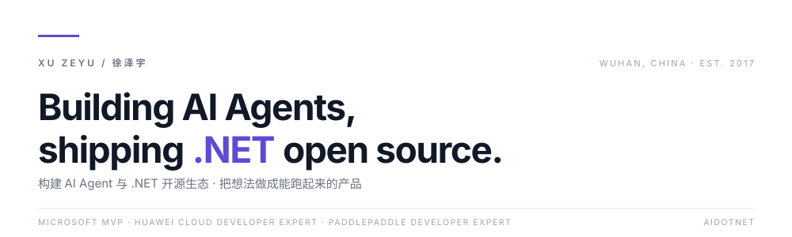
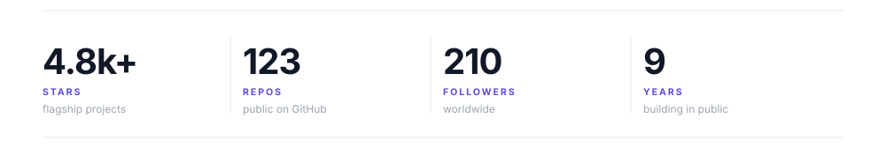

<picture>  
  <source media="(prefers-color-scheme: dark)" srcset="https://raw.githubusercontent.com/xuzeyu91/xuzeyu91/main/assets/header-dark.svg">  
    
</picture>

  
    
    
    
    

---

## 01 — About / 关于我

许泽宇，武汉。微软 MVP（AI Platform）、华为云开发者专家、飞桨开发者专家，AIDotNet 核心成员。早年做 .NET、微服务与云原生，现在把主要精力放在 **AI Agent、LLM 应用工程化与开源工具链**上——从 Semantic Kernel、Kernel Memory 到 MCP 与 Agent 编排。喜欢把想法做成别人能直接跑起来的项目。

Xu Zeyu, based in Wuhan, China. Microsoft MVP (AI Platform), Huawei Cloud Developer Expert, PaddlePaddle Developer Expert, core member of AIDotNet. Years of .NET, microservices and cloud-native work; now focused on **AI agents, LLM application engineering and open-source tooling** — from Semantic Kernel / Kernel Memory to MCP and agent orchestration. I like shipping things people can actually run.

---

## 02 — By the numbers / 数据

<picture>  
  <source media="(prefers-color-scheme: dark)" srcset="https://raw.githubusercontent.com/xuzeyu91/xuzeyu91/main/assets/stats-dark.svg">  
    
</picture>

---

## 03 — What I work on / 在做的事

| 方向 / Focus      | 代表项目 / Projects                           | 一句话 / In one line               |
| :-------------- | :---------------------------------------- | :------------------------------ |
| **AI Agent 平台** | AntSK · WebCode · transwork               | 离线知识库、浏览器端编码 Agent、桌面 Agent 工作台 |
| **.NET 开源基础设施** | GraphRag.Net · Windows-MCP.Net · MCPP.Net | 把 GraphRAG、MCP、函数调用带进 .NET 生态   |
| **AIGC 内容工业化**  | BigBanana AI Director                     | 从剧本到成片的一站式 AI 短剧 / 漫剧生产流水线      |
| **分享与社区**       | B 站 · CSDN · 知乎 · 公众号 · AIDotNet                | 持续输出 .NET 与 AI 工程实践             |

---

## 04 — Selected work / 精选项目

| Project                                                                      | 说明 / Description                     | Stack                                    |         ★ |
| :--------------------------------------------------------------------------- | :----------------------------------- | :--------------------------------------- | --------: |
| [BigBanana-AI-Director](https://github.com/shuyu-labs/BigBanana-AI-Director) | 工业级一站式 AI 短剧 / 漫剧导演平台                | Script → Asset → Keyframe                | **2,446** |
| [AntSK](https://github.com/shuyu-labs/AntSK)                                 | 可完全离线运行的 AI 知识库 / Agent              | .NET 9 · Semantic Kernel · Kernel Memory | **1,330** |
| [transwork](https://github.com/shuyu-labs/transwork)                         | 企业级桌面 AI Agent 工作台                   | Shell · Agent Skills                     |   **287** |
| [WebCode](https://github.com/shuyu-labs/WebCode)                             | 浏览器里远程跑 Claude Code / Codex 的编码平台    | C# · Web CLI                             |   **277** |
| [Windows-MCP.Net](https://github.com/shuyu-labs/Windows-MCP.Net)             | 让 AI 助手操作 Windows 桌面的 MCP Server     | C# · MCP                                 |   **240** |
| [GraphRag.Net](https://github.com/shuyu-labs/GraphRag.Net)                   | 基于 Semantic Kernel 的 .NET 版 GraphRAG | C# · NuGet                               |   **230** |

更多项目见 [shuyu-labs](https://github.com/shuyu-labs) 与 [xuzeyu91/repositories](https://github.com/xuzeyu91?tab=repositories) / More at shuyu-labs and my repositories.

---

## 05 — Stack / 技术栈

**Languages & Runtime** · `C#` `.NET 9` `Blazor` `Python` `TypeScript` `Shell`

**AI & Agents** · `Semantic Kernel` `Kernel Memory` `MCP` `GraphRAG` `RAG` `Agent Orchestration` `Ollama / Local LLM`

**Architecture & Infra** · `Microservices` `Dapr` `Docker` `Kubernetes` `Redis` `PostgreSQL` `Azure`

---

## 06 — Elsewhere / 找到我

---

  
  📍 Wuhan, China · Open to collaborate on AI Agent \&amp; .NET open source · 欢迎交流  
如果这些项目帮到你，点个 ⭐ 就是最好的反馈 / A star is the best feedback.  

